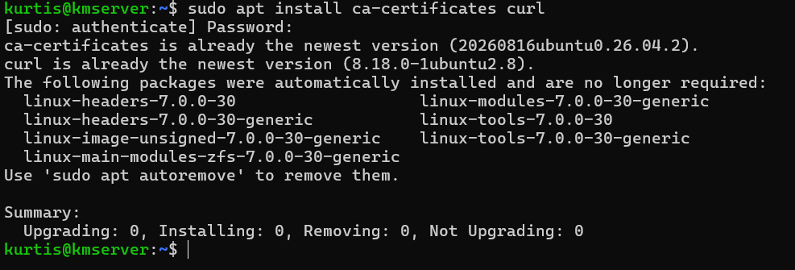
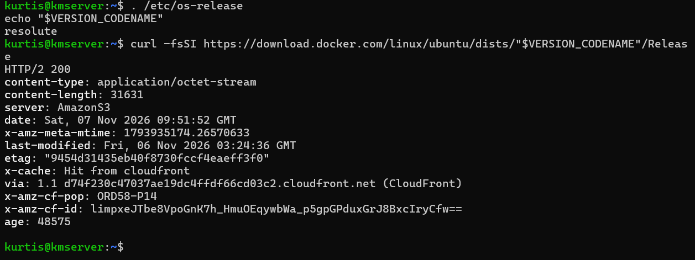
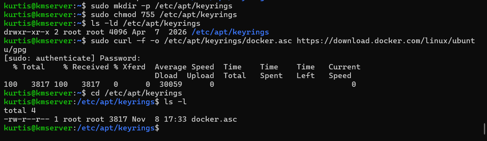
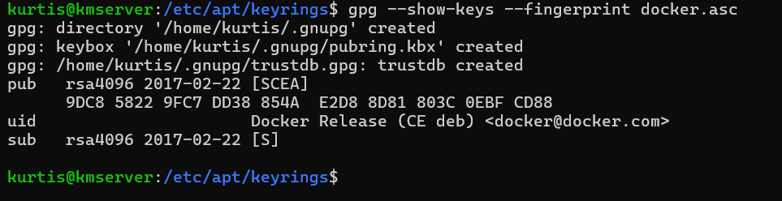
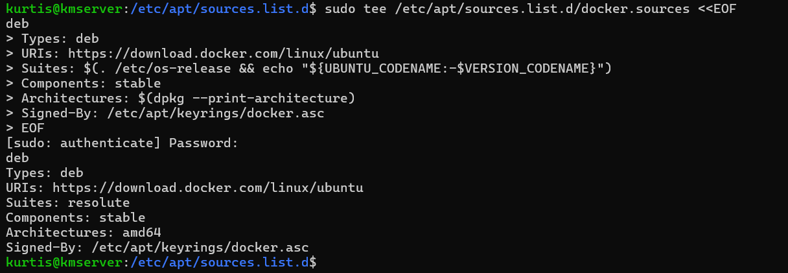
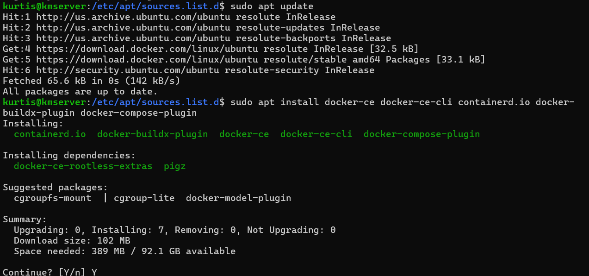
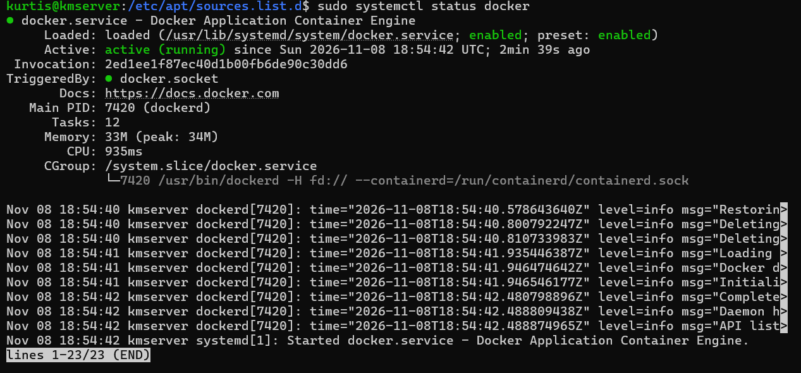
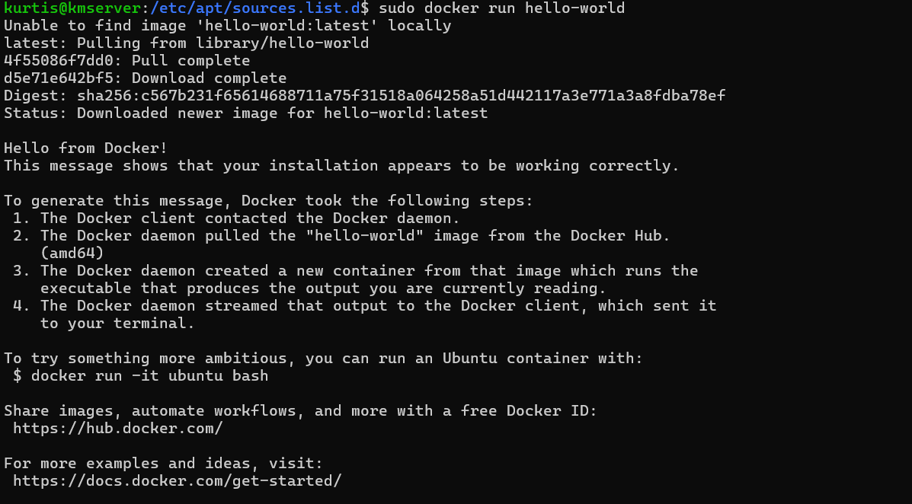

# Docker Engine Installation and Verification

**Project:** LinuxServer IT Operations Lab  
**Host:** `kmserver` (Dell OptiPlex 3060)  
**Operating system:** Ubuntu Server 26.04.1 LTS (`resolute`)  
**Outcome:** Docker Engine installed, service confirmed active, and `hello-world` container successfully executed.

## Objective

Install Docker Engine and Docker Compose from Docker's official Ubuntu package repository, verify the repository signing key, and validate that the container runtime works. Docker provides the container platform for the lab's monitoring and future IT operations services.

## Implementation

### 1. Verify prerequisites

Checked that the CA certificate package and `curl` were installed:

```bash
sudo apt install ca-certificates curl
```

APT reported that both packages were already at their newest available versions, with zero changes required. `curl` is used to retrieve content over HTTPS, and CA certificates support TLS certificate validation.



### 2. Confirm Ubuntu release and Docker repository availability

Identified the Ubuntu release codename, then checked Docker's official repository endpoint:

```bash
. /etc/os-release
echo "$VERSION_CODENAME"
curl -fsSI "https://download.docker.com/linux/ubuntu/dists/${VERSION_CODENAME}/Release"
```

The codename was `resolute`, and the endpoint returned `HTTP/2 200`. This confirmed the repository metadata was reachable; it did not by itself prove that packages were installed or trusted.



### 3. Download the repository signing key

Created the APT keyring directory, configured its directory permissions, and downloaded Docker's public signing key:

```bash
sudo mkdir -p /etc/apt/keyrings
sudo chmod 755 /etc/apt/keyrings
sudo curl -f -o /etc/apt/keyrings/docker.asc https://download.docker.com/linux/ubuntu/gpg
ls -l /etc/apt/keyrings/docker.asc
```

The key file was present and readable, owned by `root` with `644` permissions. The downloaded file was 3,817 bytes when checked.



### 4. Inspect and verify the GPG fingerprint

```bash
gpg --show-keys --fingerprint /etc/apt/keyrings/docker.asc
```

The displayed fingerprint was:

```text
9DC8 5822 9FC7 DD38 854A E2D8 8D81 803C 0EBF CD88
```

This matched the Docker signing key fingerprint published in the official Docker documentation. The fingerprint check helps confirm that the intended key was retrieved before trusting packages signed through that repository.



### 5. Configure Docker's APT source

Created `/etc/apt/sources.list.d/docker.sources` to register the Docker repository and the signing key used for repository metadata verification. The effective configuration was:

```text
Types: deb
URIs: https://download.docker.com/linux/ubuntu
Suites: resolute
Components: stable
Architectures: amd64
Signed-By: /etc/apt/keyrings/docker.asc
```

This is the resulting repository configuration, not a command to execute as-is. Its key fields identify the repository URL, distribution, package component, architecture, and signing key.



### 6. Refresh the package index and install Docker

```bash
sudo apt update
sudo apt install docker-ce docker-ce-cli containerd.io docker-buildx-plugin docker-compose-plugin
```

APT retrieved Docker's repository metadata and presented Docker Engine, CLI, `containerd`, Buildx, and Compose plugin packages for installation. The package installation was approved interactively.



### 7. Verify Docker service operation

```bash
sudo systemctl status docker
```

The Docker service reported **`active (running)`**, showing that the daemon was operating under systemd.



### 8. Test container execution

```bash
sudo docker run hello-world
```

Docker pulled the test image and successfully executed a container, which printed **“Hello from Docker!”**. This validated basic communication between the Docker CLI, Docker daemon, image registry, and container runtime.



## Results

| Validation | Observed result |
| --- | --- |
| Ubuntu codename | `resolute` |
| Docker repository reachable | HTTP 200 response |
| Repository signing key | Expected fingerprint shown |
| APT Docker source | Repository recognized by `apt update` |
| Docker service | `active (running)` |
| Container execution | `hello-world` completed successfully |

## Skills demonstrated

- Linux package management and third-party APT repository configuration
- Public-key fingerprint inspection and repository trust configuration
- Filesystem permissions and Linux CLI operations
- systemd service validation and troubleshooting fundamentals
- Docker Engine installation and container runtime verification

## Next step

Use Docker Compose to deploy a persistent monitoring service (Uptime Kuma), connect services using Docker bridge networking, and validate service availability with a controlled incident simulation.

## Reference

- [Docker Engine: Install on Ubuntu](https://docs.docker.com/engine/install/ubuntu/)
