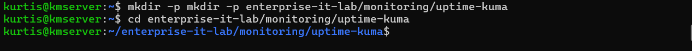
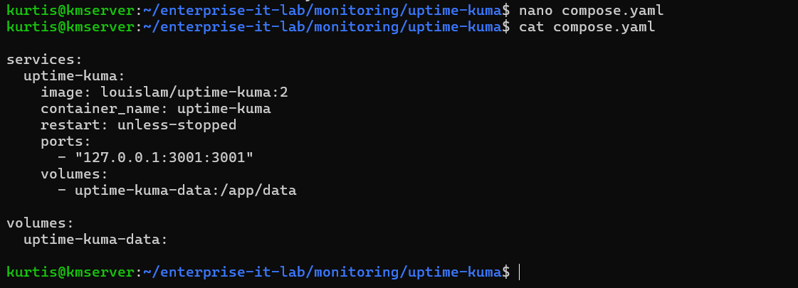
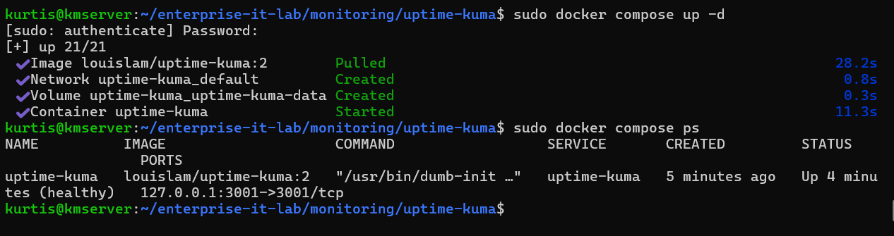
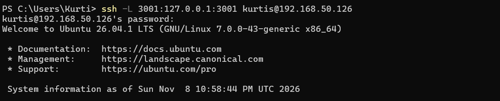
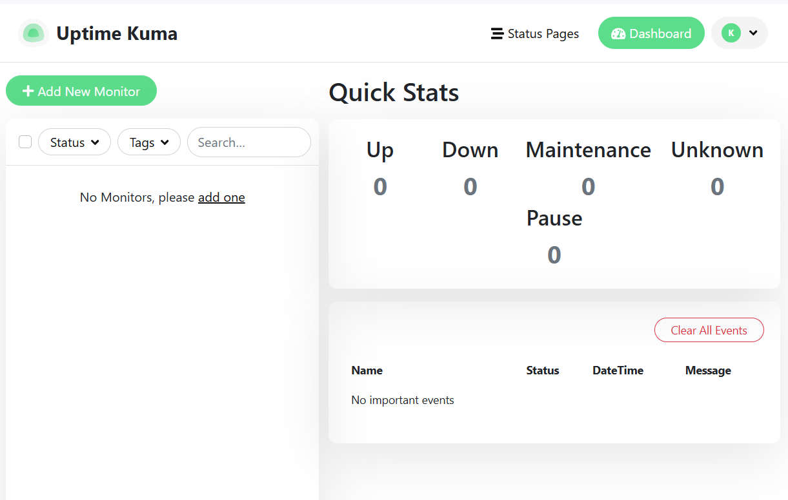
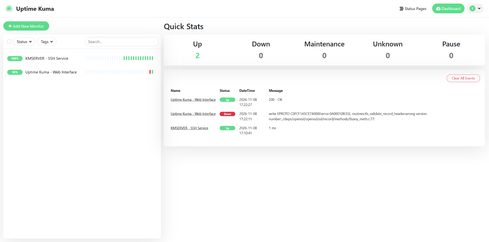
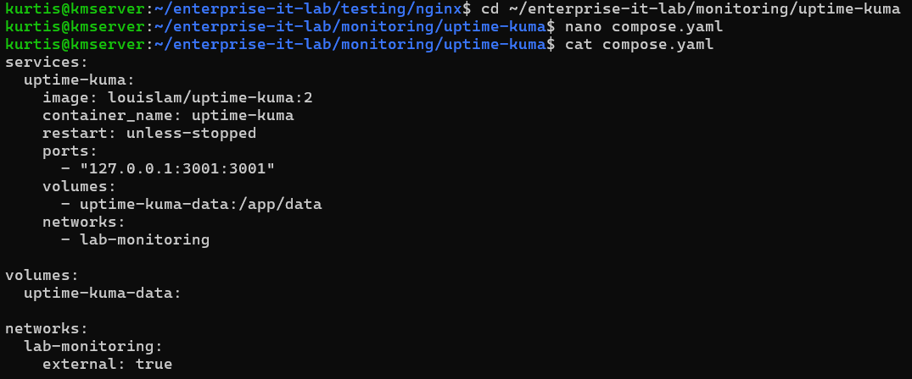

# Uptime Kuma — Service Availability Monitoring

## Overview

Deployed **Uptime Kuma** in a Docker container on a Dell OptiPlex running Ubuntu Server 26.04.1 LTS. Configured browser access through an SSH local-port tunnel, created an administrative account, and set up availability checks for the host's SSH service and the Uptime Kuma web interface. Subsequently connected the container to a shared Docker bridge network for service-to-service monitoring.

**Status:** Deployed and verified  
**Host:** `kmserver` (Ubuntu Server)  
**Monitoring:** SSH TCP port availability and Uptime Kuma HTTP availability

## Objectives

- Deploy a self-hosted monitoring application using Docker Compose.
- Persist application configuration and monitoring history in a Docker volume.
- Access its administrative interface without exposing the web port across the LAN.
- Configure and verify availability monitors.
- Establish a shared Docker network for monitoring other containers.

## 1. Project directory and deployment

Created a dedicated directory for the service:

```bash
mkdir -p ~/enterprise-it-lab/monitoring/uptime-kuma
cd ~/enterprise-it-lab/monitoring/uptime-kuma
nano compose.yaml
```



*Evidence: created the dedicated Uptime Kuma service directory.*



*Evidence: initial Compose deployment file, before the shared-network improvement.*

The file below shows the **final Compose configuration**, including the shared network added after initial deployment. The initial deployment did not declare `lab-monitoring`.

```yaml
services:
  uptime-kuma:
    image: louislam/uptime-kuma:2
    container_name: uptime-kuma
    restart: unless-stopped
    ports:
      - "127.0.0.1:3001:3001"
    volumes:
      - uptime-kuma-data:/app/data
    networks:
      - lab-monitoring

volumes:
  uptime-kuma-data:

networks:
  lab-monitoring:
    external: true
```

**Configuration highlights:**

- `image` specifies the Uptime Kuma Docker image (major version 2).
- `restart: unless-stopped` restarts the container after unplanned stops or host restarts unless it was deliberately stopped.
- Binding to `127.0.0.1:3001` restricts the host-published port to the server's loopback interface.
- The named volume retains Uptime Kuma's application data when a container is recreated.
- The external network provides connectivity to other containers without requiring their application ports to be published on the host.

Started and checked the service:

```bash
sudo docker compose up -d
sudo docker compose ps
```



*Evidence: Uptime Kuma image pulled, volume created, container started, and service reported healthy.*

## 2. Secure remote administration

From a **separate Windows PowerShell session**, established a local SSH port forward:

```powershell
ssh -L 3001:127.0.0.1:3001 kurtis@192.168.50.126
```

With the tunnel open, visited `http://localhost:3001` in the Windows browser. Created the Uptime Kuma admin account and selected its SQLite database option.

**Why the tunnel matters:** browser requests sent to the Windows machine's local port 3001 pass through the encrypted SSH connection to the Linux host's loopback port 3001. The Uptime Kuma web interface is not directly published to the LAN through Docker.

> The `192.168.50.126` address is an example from this private home-lab network. Other deployments should use their own server address. Do not expose the Uptime Kuma admin page directly to the public internet.



*Evidence: SSH local port forwarding from Windows to the Ubuntu server.*



*Evidence: successful browser access to the newly initialized monitoring dashboard.*

## 3. Initial availability checks

Configured the following monitors in the Uptime Kuma dashboard:

| Monitor | Type | Target | Interval | What it checks |
| --- | --- | --- | --- | --- |
| `KMSERVER - SSH Service` | TCP Port | `192.168.50.126:22` | 60 seconds | Whether TCP port 22 is reachable from the monitoring container |
| `Uptime Kuma - Web Interface` | HTTP(s) | `http://127.0.0.1:3001` | 60 seconds | Whether Kuma's own HTTP interface responds inside its container |

**Results:** Both monitors were confirmed as **UP**.

**Troubleshooting note:** The web-interface check initially used `https://127.0.0.1:3001` and showed **DOWN**. Changing the URL to `http://127.0.0.1:3001` corrected the protocol mismatch, and the monitor returned to **UP**.



*Evidence: two monitors displayed as UP after correcting the HTTP/HTTPS configuration issue; the event log retains the initial protocol error.*

The TCP check establishes SSH *availability*, **not** successful login, active SSH sessions, or failed authentication attempts. The self-monitor is useful for verifying the HTTP endpoint while Kuma is running, but it cannot notify an administrator if Kuma itself is offline.

## 4. Shared monitoring network

Created a user-defined Docker bridge network:

```bash
sudo docker network create lab-monitoring
sudo docker network ls
```

Connected the existing Uptime Kuma container to that network during initial testing:

```bash
sudo docker network connect lab-monitoring uptime-kuma
```

After demonstrating container-to-container communication with a test Nginx service, updated the Uptime Kuma `compose.yaml` to declare `lab-monitoring` as an **external** network. This makes the network attachment part of the recorded Compose configuration rather than relying on a manual `docker network connect` command after each recreation.

Checked the network membership:

```bash
sudo docker network inspect lab-monitoring
```

The inspection output confirmed Uptime Kuma joined the shared network. A later outage simulation using a separate Nginx container is documented in the incident reporting section of this repository.

**Reproducibility note:** Since the network is external, create `lab-monitoring` before applying this final Compose file. Review configuration before deploying it in a different environment.



*Evidence: persistent Compose network declaration referencing the external `lab-monitoring` network.*

## 5. Validation and outcomes

| Validation | Observed outcome |
| --- | --- |
| Docker Compose deployment | Uptime Kuma container started successfully |
| Browser access through SSH forwarding | Admin setup page accessible from Windows |
| SQLite setup | Initial configuration completed |
| SSH availability check | **UP** |
| Uptime Kuma HTTP availability check | **UP** after correcting HTTP/HTTPS mismatch |
| Shared Docker network | Connected and verified with `docker network inspect` |

## 6. Lessons learned and limitations

- Docker Compose provides repeatable deployment settings and persistent storage.
- SSH local-port forwarding gives remote browser access without publishing the web application to the LAN.
- Containers have isolated network namespaces: `127.0.0.1` refers to the container itself when checked from inside that container.
- An application can appear healthy while other parts of the host are unhealthy; additional performance and log monitoring will be needed.
- Host-local monitoring cannot independently detect a total host shutdown or monitor failure.

## Next steps

- Add independent host performance monitoring with Prometheus, Node Exporter, and Grafana.
- Add a notification or incident ticket workflow.
- Capture additional Nginx outage and recovery screenshots for the separate incident-report section.
