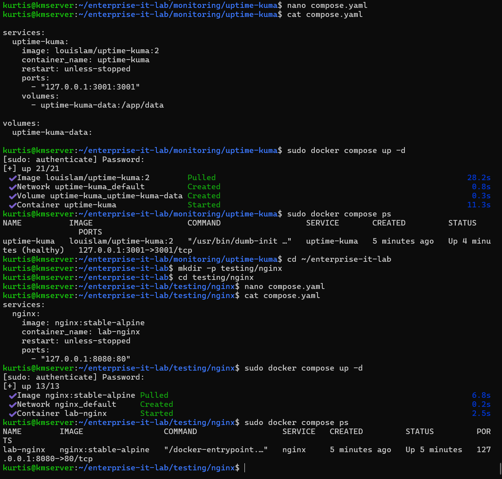
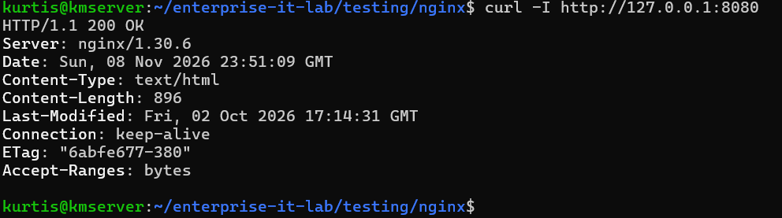
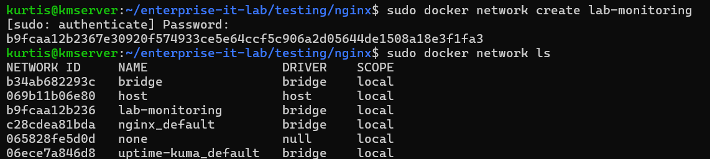
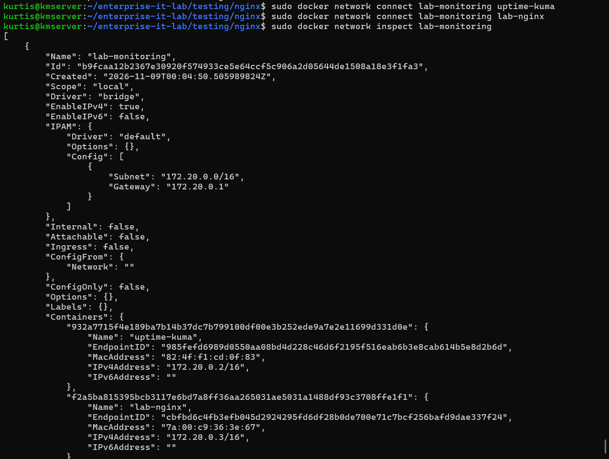
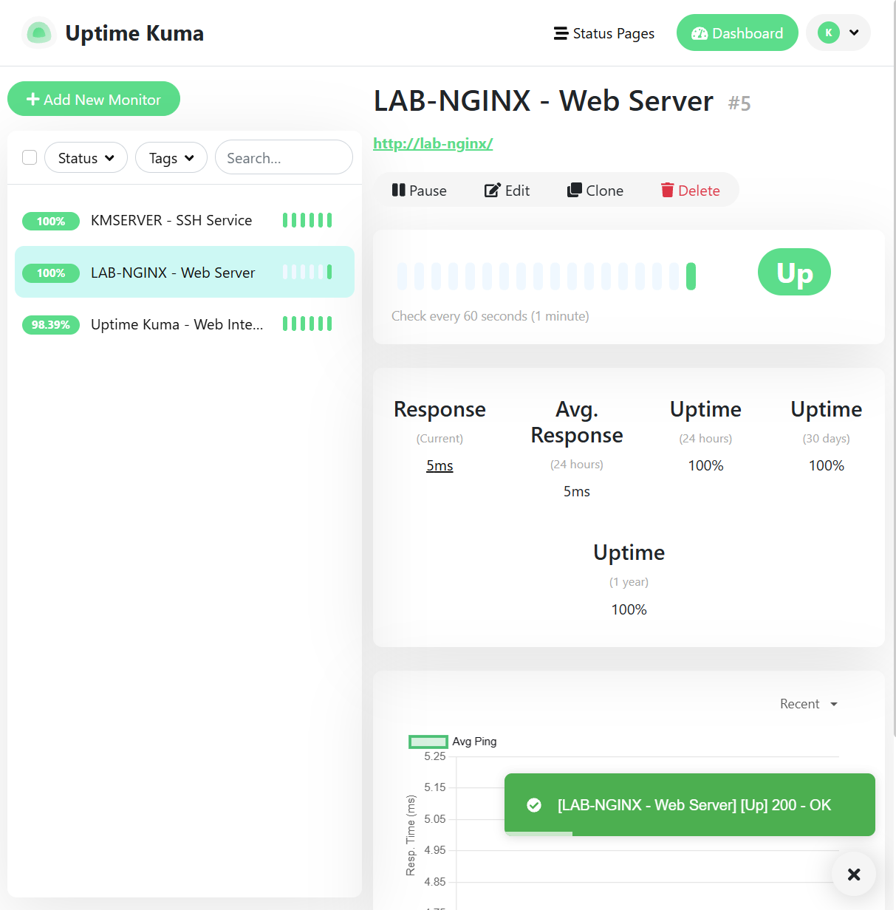
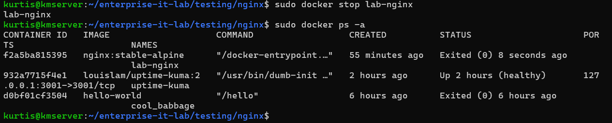
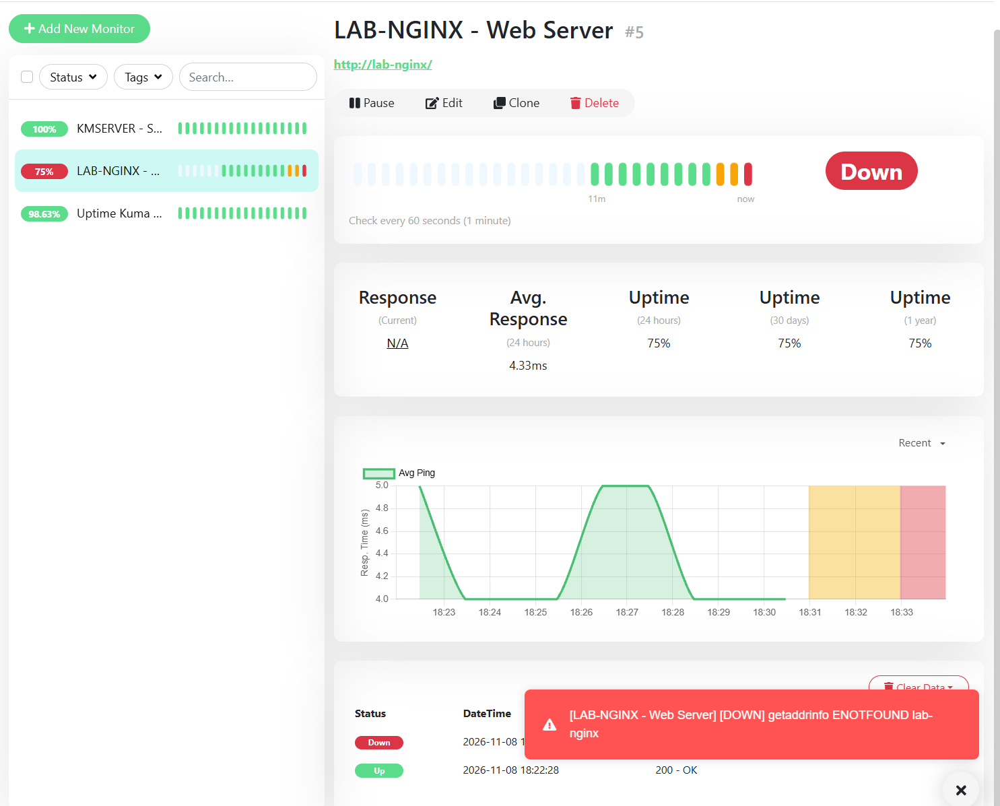
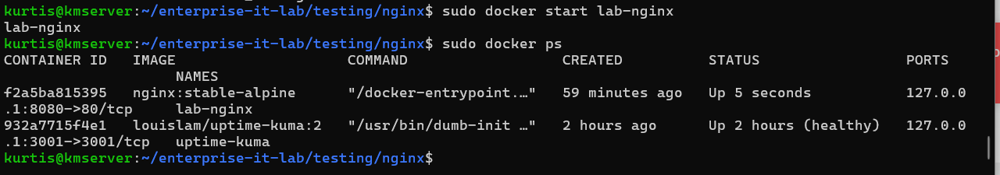
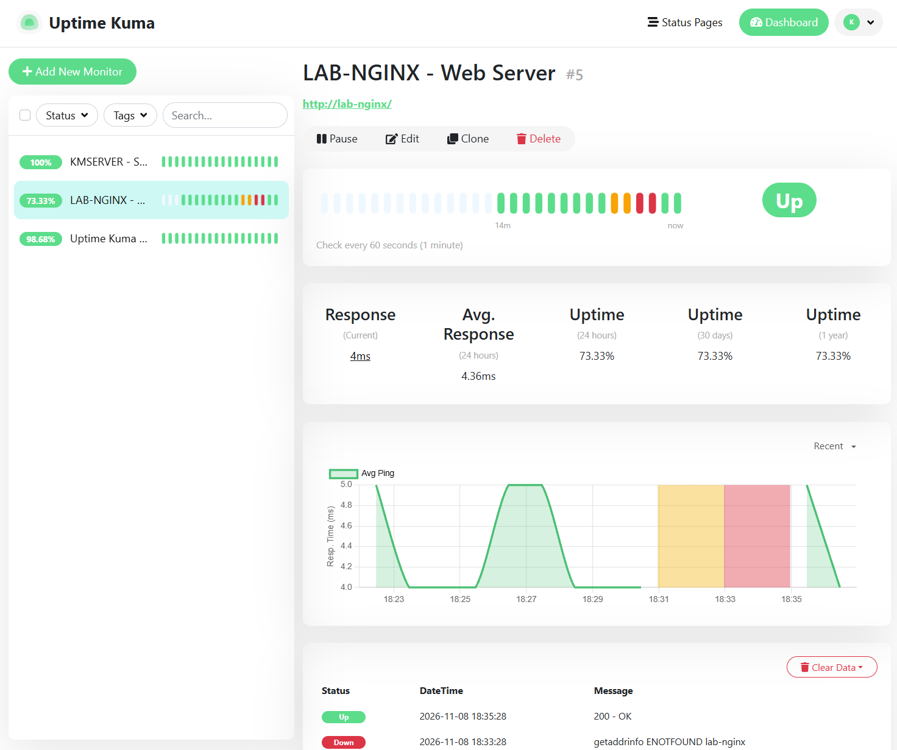
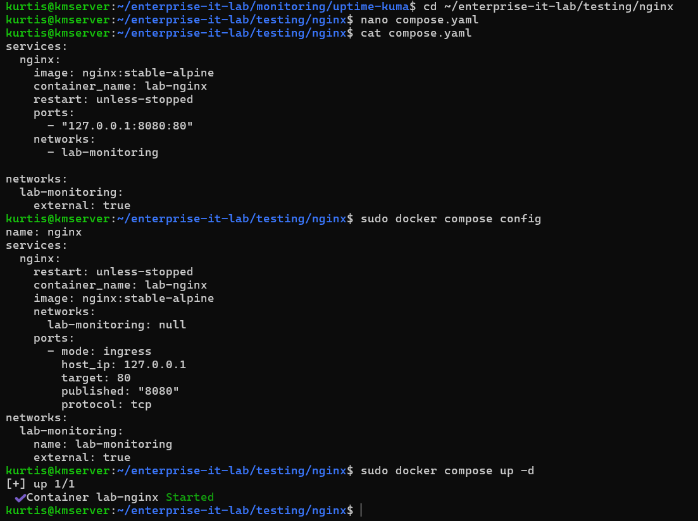

# Nginx Availability Monitoring and Controlled Outage Lab

## Overview

Created a disposable Nginx HTTP service in Docker, connected it to Uptime Kuma on a shared user-defined bridge network, and performed a controlled outage-and-recovery test. The purpose was to validate monitoring behavior and document an incident lifecycle; this was **not** a production outage.

**Environment:** Ubuntu Server 26.04.1 LTS on a Dell OptiPlex 3060; Docker Engine/Compose; Nginx (`nginx:stable-alpine`); Uptime Kuma.

**Outcome:** HTTP service reachable, outage observed by Uptime Kuma, service manually restored, monitoring returned to UP. See [INC-001 incident report](../../incident-reports/INC-001-nginx-outage.md).

## 1. Deploy a disposable HTTP service

Created a dedicated directory and used Docker Compose to deploy a test Nginx container:

```bash
mkdir -p ~/enterprise-it-lab/testing/nginx
cd ~/enterprise-it-lab/testing/nginx
nano compose.yaml
sudo docker compose up -d
sudo docker compose ps
```

The initial Compose definition published Nginx's port 80 only on the host loopback interface at `127.0.0.1:8080`. The final version also declares the shared `lab-monitoring` network and is preserved as [`compose.yaml`](compose.yaml).



Validated the web server on the Ubuntu host:

```bash
curl -I http://127.0.0.1:8080
```

The server returned **`HTTP/1.1 200 OK`**, confirming an HTTP response.



## 2. Configure container-to-container communication

Created a user-defined Docker bridge network, allowing the Uptime Kuma container to reach Nginx through Docker DNS rather than through the host's published port:

```bash
sudo docker network create lab-monitoring
sudo docker network ls
sudo docker network connect lab-monitoring uptime-kuma
sudo docker network connect lab-monitoring lab-nginx
sudo docker network inspect lab-monitoring
```





The network inspection showed `uptime-kuma` and `lab-nginx` attached to `lab-monitoring` and assigned private addresses on its `172.20.0.0/16` subnet. These container IPs are not fixed; the monitor uses the container name instead.

**Monitor configuration:** Uptime Kuma → HTTP(s) → `http://lab-nginx:80`, with a 60-second check interval. The service initially showed **UP**.



## 3. Controlled service interruption

Stopped only the Nginx container, leaving Uptime Kuma and the host operating:

```bash
sudo docker stop lab-nginx
sudo docker ps -a
```



Uptime Kuma reported **DOWN** for the monitored Nginx endpoint and displayed a name-resolution failure (`ENOTFOUND lab-nginx`) while the container was stopped. This demonstrates the availability monitor observed an interruption; the exact error reflects the container name becoming unavailable to Docker DNS during the test.



## 4. Service restoration and confirmation

Restarted Nginx and verified Docker listed it as running:

```bash
sudo docker start lab-nginx
sudo docker ps
```



Uptime Kuma subsequently showed **UP** and a `200 - OK` response.



## 5. Make network membership reproducible

The initial `docker network connect` commands attached the *running* containers to the shared network but did not preserve that configuration in Compose. Updated both projects to declare `lab-monitoring` as an external network, then validated and applied the Compose configuration:

```bash
sudo docker compose config
sudo docker compose up -d
```

The final Nginx file in this folder includes:

```yaml
    networks:
      - lab-monitoring
# top-level section:
networks:
  lab-monitoring:
    external: true
```

The [Uptime Kuma Compose file](../../monitoring/uptime-kuma/compose.yaml) declares the same network. Because it is external, the network must exist before deploying these stacks (`docker network create lab-monitoring`).



## 6. Findings and follow-up

- Confirmed HTTP service deployment and successful `200 OK` responses.
- Established service-to-service connectivity through a Docker bridge network.
- Demonstrated controlled monitoring detection, manual restoration, and monitoring confirmation.
- Identified the importance of declaring network dependencies in Compose instead of relying on manual container modifications.
- Created a formal incident record: [INC-001](../../incident-reports/INC-001-nginx-outage.md).

**Lab status:** Completed. The Nginx container may be removed using `sudo docker compose down` while keeping this Compose file for future redeployment. If doing so, pause the Uptime Kuma test monitor to prevent expected downtime alerts.

