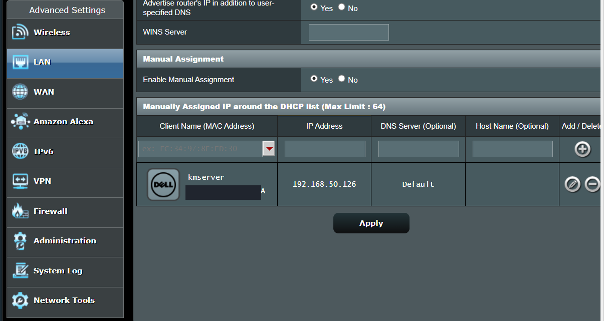
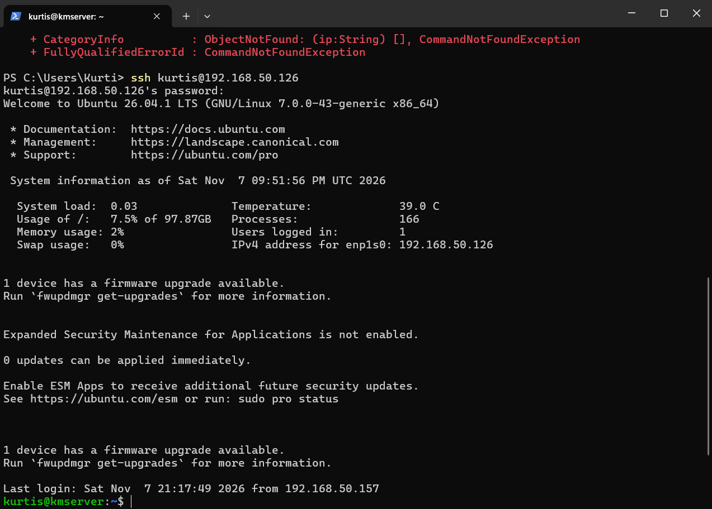
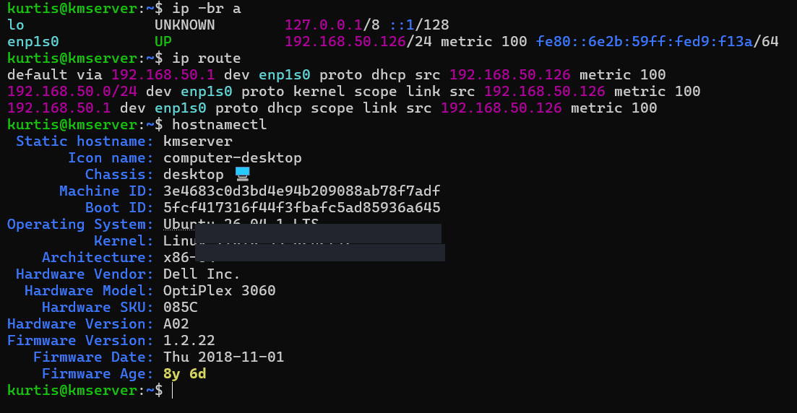

# Ubuntu Server Infrastructure Setup

Part of the [LinuxServer-it-operations-lab](../README.md) portfolio project.

## Objective

Repurpose a used Dell OptiPlex 3060 as a dedicated Linux server for a hands-on IT operations lab. Establish a reliable network configuration and enable remote command-line administration from a Windows workstation.

## Environment

| Component | Configuration | 
| --- | --- |
| Server hardware | Dell OptiPlex 3060 |
| Operating system | Ubuntu Server 26.04.1 LTS |
| Server hostname | `kmserver` |
| Network interface | `enp1s0` (Ethernet) |
| LAN address | `192.168.50.126/24` |
| Default gateway | `192.168.50.1` |
| IP assignment | Router-based DHCP reservation |
| Remote management | OpenSSH / Windows PowerShell |

> The LAN addresses shown are private RFC 1918 addresses. The DHCP reservation is configured on the router; the Ubuntu interface still receives its address through DHCP. Screenshots have device identifiers redacted for public sharing.

## Implementation

### 1. Install Ubuntu Server

1. Acquired a used Dell OptiPlex and chose to repurpose its internal drive for Linux.
2. Prepared a bootable USB installer using an Ubuntu Server ISO.
3. Booted the Dell from USB and completed the Ubuntu Server installation, replacing the existing Windows partitions.
4. Configured the initial server profile and enabled **OpenSSH Server** during installation.
5. Updated Ubuntu's package information and installed available software updates.

### 2. Reserve a consistent LAN address

Configured a **DHCP reservation** in the router's LAN settings, assigning `192.168.50.126` to the Dell's Ethernet adapter. This keeps the server address predictable for SSH and future monitoring services without manually assigning a static address within Ubuntu.



### 3. Verify SSH remote access

From Windows PowerShell, successfully connected to the Ubuntu server using:

```powershell
ssh kurtis@192.168.50.126
```

The terminal displayed the Ubuntu login banner and a shell prompt on `kmserver`, demonstrating working SSH access from a separate workstation.



### 4. Inspect server and network configuration

Ran the following commands on Ubuntu:

```bash
ip -br a
ip route
hostnamectl
```

**Verification findings:**

- `enp1s0` was **UP**, with IPv4 address `192.168.50.126/24`.
- The default route pointed to `192.168.50.1` and indicated an address assigned via DHCP.
- `hostnamectl` identified the host as `kmserver`, running Ubuntu 26.04.1 LTS on Dell OptiPlex 3060 hardware.



## Outcome

**Completed:** Ubuntu Server installation, LAN address reservation, and remote SSH access. The machine is ready to host containerized services, monitoring tools, and additional IT operations components.

## Skills demonstrated

- Linux server installation and initial administration
- Remote access using OpenSSH
- LAN addressing, subnetting, routing, and DHCP reservations
- Command-line system and network verification
- Technical documentation and evidence collection

## Next steps

See the repository's monitoring and Docker sections as those components are documented.
